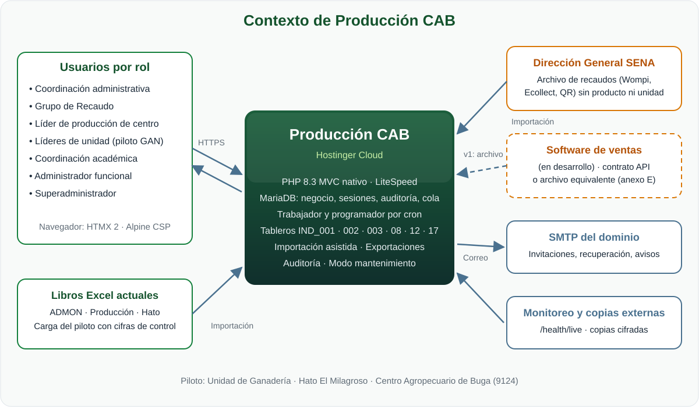

# 2. Descripción general

## 2.1 Perspectiva del producto

Producción CAB reemplaza el prototipo HTML que validó con la contraparte los tableros, las reglas de cálculo y los flujos administrativos. El prototipo cargaba los Excel normalizados en JSON, guardaba los cambios en el `localStorage` del navegador, simulaba perfiles sin autenticación y ofrecía un «escenario demostrativo» con operaciones sintéticas. Sus fórmulas (`js/metrics.js`), sus reglas de validación (`js/schemas.js`) y sus 23 pruebas (`tests/metrics.test.mjs`) son la **referencia funcional** del nuevo sistema. Las cifras verificadas se usan como oráculos de prueba (ver 2.10).

El nuevo sistema es una aplicación web *server-driven*:

- **Servidor:** PHP 8 nativo con arquitectura MVC y enrutamiento manual. Genera páginas completas y fragmentos HTML.
- **Navegador:** HTMX 2 hace los intercambios parciales y Alpine.js 3, en su versión compatible con CSP, maneja solo el estado visual.
- **Base de datos:** MariaDB, que es el motor de los planes Cloud de Hostinger. Guarda los datos de negocio, las sesiones, la auditoría y la cola de trabajos durable.
- **Trabajo pesado:** un trabajador PHP invocado por el cron de hPanel ejecuta importaciones, exportaciones, correos y verificaciones fuera de la solicitud.

**Sistemas e interfaces externas:**

| Actor o sistema externo | Relación con Producción CAB | Mecanismo en la versión 1.0 |
|---|---|---|
| Dirección General SENA | Envía el archivo de recaudos de las pasarelas, sin producto ni unidad | Importación asistida del Excel (RF-030) |
| Software de ventas del centro (en desarrollo) | Generará la base de producción (recepciones) y ventas (salidas) | Archivo con el formato del contrato (RF-096); API especificada (RF-095) |
| Libros Excel actuales | Fuente de la carga inicial y de las actualizaciones del piloto | Importación asistida con plantillas (RF-083 a RF-094) |
| Servidor de correo (SMTP de Hostinger) | Notificaciones, recuperación de cuenta, resultados de trabajos | Cola de trabajos con reintentos y cortacircuitos (RNF-008) |
| Monitoreo externo | Verificación de disponibilidad | `GET /health/live` (ROB-012) |
| Hostinger Cloud | Alojamiento, MariaDB, cron, SSL, respaldos del plan | hPanel, SSH y SFTP (sección 4.8) |

## 2.2 Funciones del producto

| Módulo | Funciones principales | Usuarios principales |
|---|---|---|
| Tablero central | KPI de presupuesto, recaudo y autoconsumo; IND_001 por unidad; IND_002 por proceso; cobertura de fuentes; conciliación del periodo; navegación a la unidad | Coordinación administrativa, Grupo de Recaudo, Líder de producción de centro; líder de unidad solo con su unidad |
| Tablero técnico de unidad (piloto Ganadería) | IND_003, IND_08, IND_12 e IND_17; panel de salud reproductiva; interruptor del lote de práctica | Líder de unidad, Coordinación académica, Líder de producción de centro |
| Presupuesto y gastos | Asignaciones anuales con desglose; gastos ejecutados con componente académico; ejecución por línea; cierre de periodos | Coordinación administrativa, líder de unidad |
| Recaudos | Importación del archivo de la DG; clasificación por unidad y producto; conciliación con ventas; consulta | Grupo de Recaudo (gestión); demás roles (consulta) |
| Producción y salidas | Recepciones de lotes; salidas de venta directa y autoconsumo; existencias; procesos de autoconsumo | Líder de unidad, Líder de producción de centro, Coordinación administrativa (procesos) |
| Transformación láctea | Vínculo entre la entrega de leche y el derivado recibido, con creación de la recepción en el mismo flujo | Líder de unidad, Coordinación académica |
| Hato | Inventario por cortes, estado reproductivo, semáforos y lote de práctica | Líder de la unidad pecuaria, Coordinación académica |
| Importaciones | Plantillas, carga, validación, vista previa, aplicación, reversión e historial | Según la fuente (RF-092) |
| Calidad de datos | Bandeja de incidencias (vínculos faltantes, conceptos sin homologar) y su corrección | Líder de producción de centro, Grupo de Recaudo, líderes de unidad |
| Exportaciones | XLSX, CSV y PDF asíncronos con descarga autorizada | Todos, según su alcance |
| Sistema | Usuarios, roles, auditoría, colas, salud, mantenimiento, funcionalidades | Superadministrador y Administrador funcional |

## 2.3 Características de los usuarios

Los perfiles de la guía se mantienen: el **Usuario 1** (tablero central) agrupa a la Coordinación Administrativa, el Grupo de Recaudo y el Líder de Producción de Centro, y el **Usuario 2** (tablero de unidad) agrupa a los Líderes de Unidad y la Coordinación Académica. Se añaden los dos roles técnicos que exige la plantilla.

| Rol (código) | Responsabilidad | Alcance de datos | Equivalente en el prototipo | 2FA |
|---|---|---|---|---|
| Superadministrador (`superadministrador`) | Administración técnica global: usuarios, roles, configuración, modo mantenimiento, auditoría, colas y salud. No opera datos de negocio. | Todos los centros, solo para funciones de sistema | No existía | Obligatoria |
| Administrador funcional (`administrador`) | Usuarios de su centro (excepto superadministradores), catálogos, unidades, parámetros y configuración funcional | Su centro | Parte de «Coordinación administrativa» | Obligatoria |
| Coordinación administrativa (`coordinacion_administrativa`) | Presupuesto, procesos de autoconsumo, gastos y cierres de periodo; consulta del tablero central y de recaudos (**no registra recaudos**) | Todas las unidades de su centro | «Coordinación administrativa» | Configurable; se recomienda activarla |
| Grupo de Recaudo (`grupo_recaudo`) | Importación, clasificación y conciliación de recaudos; consulta del tablero central | Recaudos de todas las unidades de su centro | No existía (Usuario 1 de la guía) | Configurable; se recomienda activarla por el manejo de datos personales |
| Líder de producción de centro (`lider_produccion_centro`) | Producción de todas las unidades; catálogo de productos y homologaciones; importaciones de producción y ventas; bandeja de calidad | Todas las unidades de su centro | No existía (Usuario 1 de la guía) | Configurable |
| Líder de unidad productiva (`lider_unidad`) | Operación de su unidad: recepciones, salidas, gastos, hato y transformaciones; tableros solo de su unidad | Unidades asignadas | «Líder de unidad productiva» | Configurable |
| Coordinación académica (`coordinacion_academica`) | Lote de práctica, disponibilidad didáctica y transformaciones del taller de lácteos; consulta técnica | Unidades asignadas para gestión académica; consulta técnica del centro | «Coordinación académica» | Configurable |

**Perfil de los usuarios:**

- Son funcionarios e instructores del centro, con competencia ofimática media.
- Usan sobre todo un computador de escritorio, y el móvil en campo (hato, recepción de producción).
- La conectividad en las unidades productivas puede ser variable. Por eso la interfaz prioriza respuestas ligeras, estados de carga claros y la conservación de lo escrito ante errores.

## 2.4 Restricciones

**Técnicas (plantilla del proveedor)**

- Backend en PHP 8.x nativo con MVC estricto, enrutamiento manual y PDO, sin frameworks pesados. Se admiten librerías Composer puntuales y aprobadas (ADR-005): OpenSpout para leer y escribir XLSX en *streaming*, PHPMailer para SMTP y PHPUnit para pruebas.
- Frontend en HTML5, HTMX 2.x, Alpine.js 3.x (versión CSP) y Tailwind CSS compilado. El estilo es Skeuomorfismo funcional de nivel sutil.
- Base de datos MySQL 8.x con InnoDB. Hostinger Cloud usa MariaDB, así que se aplica la decisión D-01: SQL compatible con MariaDB 10.6 o superior y con MySQL 8.0 o superior.
- Despliegue 100 % compatible con Hostinger. Restricciones del plan Cloud:
  - Servidor LiteSpeed compatible con `.htaccess`.
  - Sin acceso root y sin procesos persistentes.
  - Cron de hPanel con intervalo mínimo de un minuto.
  - Sin Redis.
  - Límites de procesos PHP y de conexiones de base de datos que deben verificarse.
- Identificadores, documentación y mensajes en español (`camelCase`, `PascalCase` y `snake_case`), sin tildes ni `ñ` en los identificadores.
- Documentación obligatoria de procesos y evidencia de todo lo generado con IA (familia RDOC).

**Normativas**

- Protección de datos personales: Ley 1581 de 2012 y sus decretos reglamentarios.
- Transparencia: Ley 1712 de 2014.
- Archivo y retención documental: Ley 594 de 2000 y TRD del SENA.
- Accesibilidad: WCAG 2.2 AA, que cubre lo exigido por la Resolución 1519 de 2020 (WCAG 2.1 AA).
- Procedimientos institucionales GOR-P-004 (seguimiento presupuestal y de ingresos) y GRF-I-005 (autoconsumo), citados en la guía.

**De los datos fuente**

- Los cortes de tiempo son distintos:
  - Recaudos: del 1 al 24 de abril de 2026.
  - Salidas: de octubre de 2025 a enero de 2026.
  - Presupuesto: vigencia 2026.
  - Hato: corte del 9 de noviembre de 2026.

  No deben presentarse como información sincronizada.
- La trazabilidad es incompleta:
  - 145 de las 146 salidas no encuentran recepción.
  - Las 17 entregas de autoconsumo carecen de un proceso válido.
  - Un recaudo está rotulado «Ganadería y Granja» y no tiene una unidad inequívoca.
- El archivo de recaudos de la DG trae datos personales de los pagadores (identificación y nombres), que no son necesarios para los indicadores.

**Organizacionales**

- La contraparte no estará disponible en la pausa de fin de año (supuesto S-16).
- El piloto se limita a la Unidad de Ganadería.

## 2.5 Dependencias

| Dependencia | Descripción | Impacto si falta | Mitigación |
|---|---|---|---|
| Plan Hostinger Cloud y su MariaDB | Versión del motor de 10.6 o superior, cron por minuto, SSH y límites del plan | Sin SKIP LOCKED la cola usa la estrategia alternativa; con límites insuficientes no se alcanzan los SLO | Verificación en la iteración 0 (sección 4.8); estrategia de reclamo configurable (RF-Q-006) |
| Formato del archivo de recaudos de la DG | Encabezados en la fila 3 y periodo en la fila 2 | Errores de importación | Mapeo por nombre normalizado; plantilla versionada (RF-086) |
| Software de ventas | Producción del archivo o API con el contrato del anexo E | Carga manual o desde Excel | Importación con formato equivalente (RF-096) |
| Correo SMTP del dominio | Envío de notificaciones y recuperación | Los usuarios no pueden recuperar su cuenta | Cortacircuitos, reintentos y restablecimiento por el administrador con verificación (RAC-014) |
| Identidad visual SENA | Autorización del uso de marca y logotipo | Uso de marca no autorizado | Sin logotipo hasta tener autorización; paleta del prototipo (S-03) |
| TRD del SENA | Plazos de retención | Retención mal definida | Supuesto S-17 y validación con gestión documental |
| Datos actualizados del piloto | BBDD Excel de Ganadería al día | Indicadores pendientes | Carga inicial asistida con cifras de control (RF-094) |

## 2.6 Variables del proyecto

La plantilla del SRS exige completar estas variables antes de generar el documento. Los valores provienen de la guía, del prototipo, de la revisión del mockup y de las decisiones del proveedor. Los que no pudieron confirmarse se marcan PENDIENTE DE VALIDACIÓN y se detallan en 2.7.

| Variable | Valor adoptado |
|---|---|
| [TEMA_PROYECTO] | Gestión y analítica de la producción de los centros de formación SENA: presupuesto, recaudo, autoconsumo, trazabilidad de lotes, transformación láctea, inventario biológico y tableros de mando. Piloto en la Unidad de Ganadería (Hato El Milagroso) del Centro Agropecuario de Buga. |
| [NOMBRE_SISTEMA] | **Producción CAB** (S-01). |
| [OPCION_LAYOUT] | Opción 2 (sidebar comprimible) como contenedor general; Opción 1 (bento grid) en los tableros; Opción 8 (tablas densas) en los módulos administrativos. Ver D-18. |
| [IDENTIDAD_VISUAL] | Paleta del prototipo y de la guía: • Verde #15803D: venta directa y éxito. • Ámbar #D97706: autoconsumo y advertencia. • Azul #4A718F y gris azulado #7896A9: presupuesto. • Menú #102F2C, fondo #F4F6F8, texto #1A2938 y error #C34747. Tipografía Inter; cifras tabulares. La paleta y el uso de marca se validarán con el manual SENA (S-03). |
| [ESTILO_VISUAL] | Skeuomorfismo funcional. |
| [NIVEL_ESQUEUOMORFISMO] | Sutil. |
| [MODELO_AUTORIZACION] | Híbrido: RBAC (rol y permiso) más ABAC (centro, unidades asignadas, estado del registro, periodo abierto y propiedad). |
| [ESTRATEGIA_AISLAMIENTO_DATOS] | MariaDB con políticas en servidor equivalentes a nivel de fila (`centro_id` y `unidad_id`), repositorios con alcance obligatorio y denegación por defecto. No hay RLS nativo. |
| [POLITICA_2FA] | TOTP obligatorio para Superadministrador y Administrador. Configurable para los demás roles, con recomendación de activarlo en el Grupo de Recaudo y la Coordinación administrativa. |
| [DATOS_SENSIBLES] | • Datos personales: identificación y nombres de pagadores, que se minimizan, y datos de usuarios (nombre, correo, IP, agente). • Datos financieros: presupuestos, recaudos, facturas y referencias de pago. • Secretos: contraseñas, semillas TOTP y claves. • Datos zootécnicos: no son personales. No hay datos de salud humana. |
| [CONTEXT_ADDITIONAL] | Guía de especificaciones con tres comentarios, prototipo con su README, PLAN y VERIFICACION y 23 pruebas, revisión del mockup con seis observaciones y estructura de los Excel fuente (anexo G). |
| [COSTO_HORA_SENIOR] | 50 USD (valor por defecto). |
| [COSTO_HORA_MID] | 30 USD (valor por defecto). |
| [COSTO_HORA_JUNIOR] | 18 USD (valor por defecto). |
| [HOSTING_Y_CAPACIDAD] | Hostinger Cloud Startup o Professional. Valores de referencia de la tabla v6 de Hostinger, que deben verificarse en hPanel: • Startup: unos 2 núcleos, 3 GB de RAM y 100 PHP workers. • Professional: unos 4 núcleos, 6 GB y 200 PHP workers. • Conexiones MariaDB por usuario: sin confirmar (las tablas antiguas indican 100 a 150). • MariaDB 10.6 o superior (por verificar), LiteSpeed, cron de hPanel desde un minuto, SSH, SSL Let's Encrypt y copias diarias del plan. • Sin Redis ni root. PENDIENTE DE VALIDACIÓN en la iteración 0. |
| [PERFIL_CARGA] | • Año 1: 60 cuentas, 25 activas al día y 15 sesiones simultáneas en el pico. • Tráfico: 1 req/s sostenido y 5 req/s en el pico, con ráfagas de 10 req/s. • Mezcla: 35 % tableros, 25 % listados, 15 % formularios GET, 12 % escrituras, 8 % consulta de trabajos, 3 % importaciones y exportaciones, 2 % autenticación. • Datos: carga inicial de unos 650 registros; crecimiento anual de unas 12.000 salidas, 3.000 recaudos, 3.000 recepciones y 250.000 eventos de auditoría. Ver RNF-PERF-001. PENDIENTE DE VALIDACIÓN. |
| [OBJETIVOS_RENDIMIENTO] | SLO de p95 por flujo: • Inicio de sesión: 900 ms o menos. • Tablero: 1.200 ms con caché fría y 500 ms con caché caliente. • Fragmentos de filtro: 800 / 350 ms. • Listados: 600 ms. Formularios: 700 ms. • Aceptación de trabajo: 400 ms. Consulta de estado: 250 ms. • Espera en cola: 90 s o menos. • Errores inesperados: menos de 0,5 %. Ver RNF-PERF-003 y RNF-PERF-004. PENDIENTE DE VALIDACIÓN. |
| [ENTORNO_PRUEBAS_CARGA] | Entorno de pruebas en Hostinger Cloud del mismo plan que producción, en un subdominio aislado y con su propia base de datos sintética equivalente a tres años de operación. Requiere autorización escrita del titular de la cuenta. El tráfico no supera el doble del pico (unos 16 req/s) durante 30 minutos o menos, con condiciones de parada definidas (RNF-PERF-015). |
| [PRESUPUESTO_RESPUESTA_MS] | 1.500 ms de trabajo síncrono en p95 por operación, con un límite duro de 5.000 ms. Lo que pueda superarlo va a la cola (RNF-PERF-002). |
