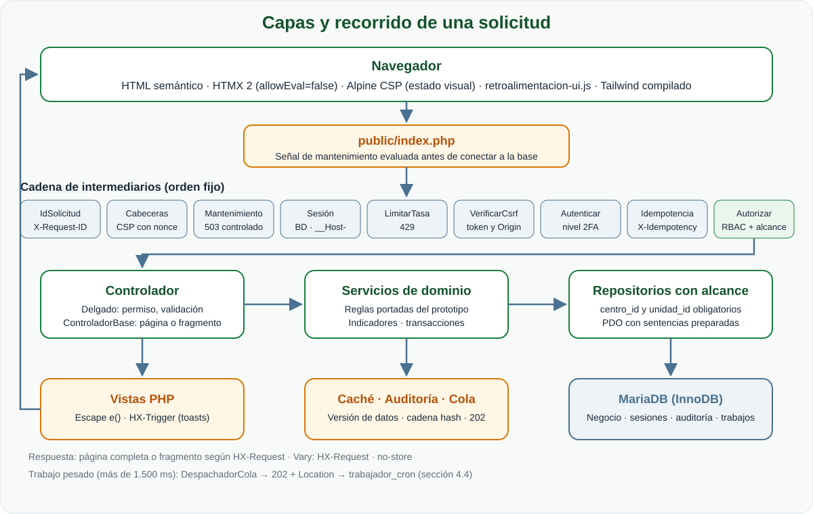

# 4. Arquitectura técnica

## 4.1 Visión general

La arquitectura es un **monolito modular** en PHP 8.3 nativo con un patrón MVC estricto. El servidor genera páginas completas y fragmentos HTML. HTMX 2 hace los intercambios parciales y Alpine.js (versión CSP) solo maneja el estado visual. Hay un único almacén durable, MariaDB, que guarda los datos de negocio, las sesiones, la auditoría y la cola. El trabajo pesado lo ejecuta un trabajador CLI invocado por el cron de hPanel. Es la solución más simple que cumple la demanda prevista (2.6); las señales para crecer están definidas en RNF-PERF-019.



**Recorrido de una solicitud**, en orden:

1. `public/index.php` carga el entorno y evalúa la **señal mínima de mantenimiento** antes de tocar la base de datos.
2. La **cadena de intermediarios** procesa la solicitud:
   - `IdSolicitud`: asigna el `X-Request-ID`.
   - `CabecerasSeguridad`: genera el nonce de la CSP y añade las cabeceras.
   - `Mantenimiento`.
   - `IniciarSesion`.
   - `LimitarTasa`.
   - `VerificarCsrf`, en las escrituras.
   - `Autenticar`.
   - `Idempotencia`, en las escrituras.
   - `Autorizar`: aplica la política de la ruta y construye el `AlcanceDatos`.
3. El **controlador**, que es delgado, valida la entrada y llama a un **servicio**.
4. El servicio aplica las reglas de negocio y usa **repositorios con alcance obligatorio** dentro de una transacción.
5. La auditoría y el despacho de trabajos se registran en la misma transacción (*outbox*).
6. La **vista** devuelve la página o el fragmento según `HX-Request`. Los mensajes al usuario viajan en `HX-Trigger`.

### 4.1.1 Estructura del repositorio

```text
produccion-cab/
├── app/
│   ├── Nucleo/            Aplicacion, Enrutador, Solicitud, Respuesta, Contenedor, BaseDatos, Entorno,
│   │                      Sesion, ManejadorSesionBd, Vista, Registro, Cifrador, Cache, LimitadorTasa,
│   │                      ErrorHttp, ErrorValidacion, GeneradorUlid, Funcionalidades
│   ├── Intermediarios/    IdSolicitud, CabecerasSeguridad, Mantenimiento, IniciarSesion, LimitarTasa,
│   │                      VerificarCsrf, Autenticar, Idempotencia, Autorizar
│   ├── Controladores/     ControladorBase, ControladorTrabajos, SaludControlador, MantenimientoControlador,
│   │                      TableroCentralControlador, TableroUnidadControlador, RecaudosControlador, …
│   ├── Politicas/         Politica (interfaz), AlcanceDatos, PoliticaRecaudos, PoliticaHato, …
│   ├── Repositorios/      RepositorioConAlcance, RepositorioRecaudos, RepositorioSalidas, …
│   ├── Servicios/         ServicioIndicadores, ServicioImportacion, ServicioAuditoria,
│   │                      ServicioMantenimiento, ServicioCorreo, ServicioTotp, ServicioContrasenas, …
│   ├── Validadores/       Validador, ReglasRecepcion, ReglasSalida, ReglasTransformacion, …
│   ├── Cola/              DespachadorCola, ConductorCola, ConductorColaMysql, ManejadorTrabajo,
│   │                      ErrorTransitorio, ErrorDefinitivo, CortaCircuitos
│   ├── Trabajos/          EnviarCorreo, ValidarImportacion, AplicarImportacion, ExportarXlsx, …
│   └── Vistas/            diseno/, parciales/, tableros/, trabajos/, errores/, correos/, …
├── config/                app.php, base_datos.php, cola.php, funcionalidades.php, seguridad.php,
│                          mantenimiento.php, cache.php, retencion.php, rutas.php
├── public/                index.php, .htaccess, .user.ini, favicon.*, site.webmanifest,
│                          assets/ (css, js, vendor, fuentes, img) con huella en el nombre
├── cli/                   trabajador_cron.php, programador.php, mantenimiento.php, migrar.php,
│                          verificar_entorno.php, crear_superadministrador.php, diccionario_datos.php,
│                          limpiar_cache.php, humo.php, registrar_despliegue.php
├── bd/                    migraciones/ (NNN_*.sql y NNN_*.down.sql), semillas/
├── almacenamiento/        (fuera de public) cache/, registros/, importaciones/, exportaciones/,
│                          adjuntos/, estado/mantenimiento.json, latidos/, bloqueos/
├── tests/                 Unitarias/, Integracion/, E2E/ (Playwright), Contrato/, carga/ (k6)
├── scripts/               desplegar.sh, backup.sh, restaurar.sh, rollback.sh, verificar_integridad.sh
└── docs/                  adr/, api/, guias/, ia/, procesos/, rendimiento/, runbooks/, seguridad/, srs/, ui/
```

### 4.1.2 Equivalencias entre los nombres de la plantilla y los del proyecto

La plantilla exige identificadores en español (D-17). Esta tabla da la trazabilidad con los nombres que ella cita:

| Nombre en la plantilla | Nombre en Producción CAB | Ubicación |
|---|---|---|
| `public/index.php` | `public/index.php` (convención de servidor) | Sección 4.2 |
| `.htaccess` | `public/.htaccess` | Sección 4.2 |
| `BaseController.php` | `ControladorBase.php` | `app/Controladores/`, sección 4.2 |
| `config/database.php` | `config/base_datos.php` | Sección 4.2 |
| `ui-feedback.js` | `retroalimentacion-ui.js` | `public/assets/js/`, sección 4.3 |
| `QueueDispatcher.php` | `DespachadorCola.php` | `app/Cola/`, sección 4.4 |
| `QueueDriver.php` | `ConductorCola.php` (interfaz) y `ConductorColaMysql.php` | `app/Cola/`, sección 4.4 |
| `cron_worker.php` | `trabajador_cron.php` | `cli/`, sección 4.4 |
| `JobController.php` | `ControladorTrabajos.php` | `app/Controladores/`, sección 4.4 |
| `config/queue.php` | `config/cola.php` | Sección 4.4 |
| `config/features.php` | `config/funcionalidades.php` | Anexo A |
| Tabla `jobs` / `failed_jobs` | `trabajos` / `trabajos_fallidos` | Sección 4.4 |
| Columnas `type, payload, status, attempts, max_attempts, available_at, locked_until, reserved_by, idempotency_key, error_message, created_at, updated_at` | `tipo, carga, estado, intentos, max_intentos, disponible_en, bloqueado_hasta, reservado_por, clave_idempotencia, mensaje_error, creado_en, actualizado_en` | Sección 4.4 |
| `health.php` | `SaludControlador.php` (rutas `/health/live` y `/health/ready`, que se conservan como contrato operativo) | Anexo D |
| `scripts/backup.sh`, `scripts/rollback.sh` | Mismos nombres (ya válidos) | Anexo D |
| `maintenance` (middleware) | `Intermediarios/Mantenimiento.php` y `cli/mantenimiento.php` | Anexo C |

### 4.1.3 Registros de decisiones de arquitectura (ADR) iniciales

| ADR | Título | Estado | Decisiones relacionadas |
|---|---|---|---|
| ADR-001 | Interfaz dirigida por el servidor con HTMX y Alpine en lugar de una SPA | Aceptado | RI-001 |
| ADR-002 | MariaDB con SQL portable a MySQL 8 | Aceptado | D-01, D-02 |
| ADR-003 | Cola durable en la base de datos con trabajador por cron, sin Redis | Aceptado | D-12 |
| ADR-004 | CSP estricta: `allowEval=false` en HTMX, Alpine CSP y retroalimentación centralizada | Aceptado | D-04 a D-08 |
| ADR-005 | Dependencias de Composer permitidas: OpenSpout, PHPMailer, PHPUnit, PHPStan | Aceptado | D-35 |
| ADR-006 | Sesiones en la base de datos con el ID convertido a hash | Aceptado | D-32 |
| ADR-007 | Autorización híbrida y repositorios con alcance obligatorio (sin RLS nativo) | Aceptado | RDI |
| ADR-008 | Auditoría encadenada por hash y exportación firmada | Aceptado | D-33 |
| ADR-009 | Gráficos SVG generados en el servidor | Aceptado | D-31 |
| ADR-010 | Caché de aplicación en archivos con versión de datos por centro | Aceptado | RNF-PERF-012 |
| ADR-011 | Despliegue por versiones con enlace atómico y migraciones *expand/contract* | Aceptado | D-14 |
| ADR-012 | IND_17 con gasto ejecutado y referencia presupuestada | Propuesto (validar S-11) | D-20 |
| ADR-013 | El escenario demostrativo se convierte en entorno de capacitación | Aceptado | D-19 |
| ADR-014 | Nombres en español y equivalencias con la plantilla | Aceptado | D-17 |
| ADR-015 | Evolución: inicio de sesión único con Entra ID y llaves de acceso WebAuthn | Propuesto | RAC-015 |

### 4.1.4 Dependencias aprobadas

| Componente | Versión | Uso | Motivo |
|---|---|---|---|
| PHP | 8.3.x (mínimo 8.2) | Servidor | Soporte de seguridad, tipos y `readonly` |
| MariaDB | 10.6 o superior (la que ofrezca el plan, por verificar) | Datos | Motor del plan Cloud; `SKIP LOCKED` disponible desde la 10.6 |
| htmx | 2.0.x (versión fijada) | Intercambios parciales | Interfaz dirigida por el servidor |
| idiomorph (extensión `morph`) | 0.7.x (fijada) | Intercambio por morfismo | Conserva el foco y el estado (D-06) |
| Alpine.js en versión CSP (`@alpinejs/csp`) | 3.14.x o superior (fijada) | Estado visual | Compatible con CSP sin `unsafe-eval` |
| Tailwind CSS (CLI independiente) | 3.4.x | Estilos compilados | Sin Node en el servidor |
| openspout/openspout | 4.x | Lectura y escritura de XLSX en *streaming* | Memoria acotada |
| phpmailer/phpmailer | 6.9.x | SMTP con TLS | Correo transaccional |
| Generador de PDF (dompdf/dompdf) | 3.x | Reportes PDF en trabajos | Solo en el trabajador (RF-081) |
| QR local (chillerlan/php-qrcode) | 5.x | QR de enrolamiento de 2FA | Sin servicios externos (RAC-010) |
| phpunit/phpunit, phpstan/phpstan, friendsofphp/php-cs-fixer | Actuales | Calidad (solo desarrollo) | No se despliegan |
| Playwright, k6, OWASP ZAP, gitleaks | Actuales | Pruebas (fuera del servidor) | No se despliegan |

> **Decisión D-37.** El cálculo de TOTP (RFC 6238) se implementa en `ServicioTotp`, con unas 60 líneas probadas con los vectores de la RFC, en lugar de añadir una dependencia. Así se reduce la superficie de la cadena de suministro en un componente crítico.
