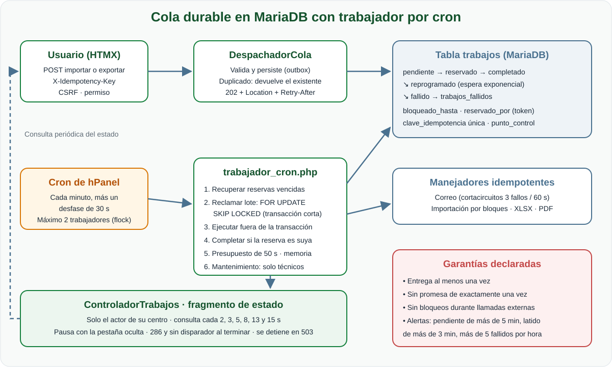

## 4.4 Arquitectura de Colas Asíncronas & Cron Jobs

### 4.4.1 Diseño

Todo trabajo que pueda superar el presupuesto síncrono de 1.500 ms, o cuya duración sea impredecible, se procesa fuera de la solicitud: correos, importaciones, exportaciones XLSX y PDF, recálculo de calidad, precalentamiento de caché y verificaciones de seguridad. La cola sigue el patrón **base de datos primero con cron**. MariaDB es el registro durable y la única fuente de verdad. El trabajador PHP CLI se invoca desde el cron de hPanel. Redis no está disponible en Hostinger Cloud (D-12).



| Paso | Componente | Garantía |
|---|---|---|
| 1. Despacho | `DespachadorCola` | Valida el permiso y la entrada, persiste el trabajo y responde 202 con `Location` y `Retry-After` solo después del commit. Ante un duplicado devuelve el trabajo existente. |
| 2. Reclamo | `ConductorColaMysql::reclamar` | Es atómico: `SELECT … FOR UPDATE SKIP LOCKED` en una transacción corta, seguido de `UPDATE` con un token de reserva y su vencimiento. La alternativa es `UPDATE … ORDER BY … LIMIT` condicional. |
| 3. Ejecución | `trabajador_cron.php` y el manejador | Fuera de la transacción de reclamo. Tiene presupuesto de tiempo y memoria propio y un latido que amplía la reserva. |
| 4. Resultado | `completar`, `reprogramar`, `fallar`, `continuar` | `WHERE id = ? AND reservado_por = ? AND estado = 'reservado'`. Una reserva perdida no se sobrescribe. |
| 5. Recuperación | `recuperarVencidos` | Al iniciar cada ejecución, las reservas vencidas vuelven a pendiente o pasan a fallidos. |
| 6. Seguimiento | `ControladorTrabajos` y el fragmento `trabajos/estado` | La consulta periódica está autorizada, con espera creciente, se pausa con la pestaña oculta y se detiene en estado final o en mantenimiento. |

**Garantías y límites declarados:**

- **Entrega al menos una vez.** Un mismo trabajo puede ejecutarse más de una vez (por ejemplo, si el trabajador cae después de un efecto externo), así que todos los manejadores son idempotentes en su operación y su ámbito.
- **Sin promesa de exactamente una vez** para efectos externos como el correo.
- **Atomicidad con el negocio.** El cambio de negocio y su trabajo se guardan en la misma transacción (*outbox*).
- **Sin bloqueos durante llamadas externas.** Ninguna transacción de la base de datos queda abierta mientras se llama a un servicio externo.
- **Carga mínima.** La carga del trabajo lleva referencias (IDs), no datos personales: el correo del destinatario se resuelve al ejecutar.

### 4.4.2 Esquema de la cola

```sql archivo=bd/migraciones/005_crear_cola_trabajos.sql
-- 005: cola durable de trabajos, trabajos fallidos y estado de cortacircuitos (RF-Q-001, RNF-008).
-- Compatible con MariaDB 10.6+ y MySQL 8.0+. Las fechas son UTC (la sesión fija time_zone = '+00:00').

CREATE TABLE trabajos (
    id                 BIGINT UNSIGNED NOT NULL AUTO_INCREMENT COMMENT 'Identificador interno',
    ulid               CHAR(26)        NOT NULL COMMENT 'Identificador público usado en URL (RBD-004)',
    cola               VARCHAR(30)     NOT NULL DEFAULT 'predeterminada' COMMENT 'Cola lógica',
    tipo               VARCHAR(60)     NOT NULL COMMENT 'Tipo registrado en config/cola.php',
    carga              JSON            NOT NULL COMMENT 'Datos mínimos del trabajo, sin secretos ni PII',
    estado             ENUM('pendiente','reservado','completado','fallido','cancelado') NOT NULL DEFAULT 'pendiente',
    prioridad          TINYINT UNSIGNED NOT NULL DEFAULT 5 COMMENT '1 = más alta',
    intentos           SMALLINT UNSIGNED NOT NULL DEFAULT 0 COMMENT 'Se incrementa al reservar',
    max_intentos       SMALLINT UNSIGNED NOT NULL DEFAULT 5,
    disponible_en      DATETIME(3)     NOT NULL COMMENT 'No se reclama antes de esta fecha (espera de reintento)',
    bloqueado_hasta    DATETIME(3)     NULL COMMENT 'Vencimiento de la reserva',
    reservado_por      CHAR(32)        NULL COMMENT 'Token de reserva del trabajador',
    clave_idempotencia VARCHAR(120)    NULL COMMENT 'X-Idempotency-Key u operación equivalente',
    actor_id           BIGINT UNSIGNED NULL COMMENT 'Usuario que originó el trabajo',
    centro_id          INT UNSIGNED    NULL,
    unidad_id          INT UNSIGNED    NULL,
    alcance            JSON            NULL COMMENT 'Alcance del actor al encolar; se reevalúa al ejecutar (RAC-024)',
    progreso           TINYINT UNSIGNED NOT NULL DEFAULT 0,
    mensaje_progreso   VARCHAR(255)    NULL,
    punto_control      JSON            NULL COMMENT 'Avance de trabajos por bloques o efectos ya realizados',
    resultado          JSON            NULL,
    mensaje_error      VARCHAR(1000)   NULL COMMENT 'Error sanitizado: sin rutas, SQL ni secretos',
    correlacion_id     CHAR(32)        NULL COMMENT 'X-Request-ID de la solicitud de origen',
    creado_en          DATETIME(3)     NOT NULL DEFAULT CURRENT_TIMESTAMP(3),
    actualizado_en     DATETIME(3)     NOT NULL DEFAULT CURRENT_TIMESTAMP(3) ON UPDATE CURRENT_TIMESTAMP(3),
    iniciado_en        DATETIME(3)     NULL,
    finalizado_en      DATETIME(3)     NULL,
    PRIMARY KEY (id),
    UNIQUE KEY uq_trabajos_ulid (ulid),
    UNIQUE KEY uq_trabajos_idempotencia (centro_id, tipo, clave_idempotencia),
    KEY idx_trabajos_reclamo (cola, estado, prioridad, disponible_en, id),
    KEY idx_trabajos_vencidos (estado, bloqueado_hasta),
    KEY idx_trabajos_actor (actor_id, creado_en),
    KEY idx_trabajos_limpieza (estado, finalizado_en),
    CONSTRAINT fk_trabajos_actor FOREIGN KEY (actor_id) REFERENCES usuarios (id),
    CONSTRAINT fk_trabajos_centro FOREIGN KEY (centro_id) REFERENCES centros (id),
    CONSTRAINT chk_trabajos_progreso CHECK (progreso <= 100),
    CONSTRAINT chk_trabajos_intentos CHECK (max_intentos BETWEEN 1 AND 20)
) ENGINE = InnoDB DEFAULT CHARSET = utf8mb4 COLLATE = utf8mb4_unicode_ci
  COMMENT = 'Cola durable de trabajos asíncronos (RF-Q-001)';

CREATE TABLE trabajos_fallidos (
    id             BIGINT UNSIGNED NOT NULL AUTO_INCREMENT,
    trabajo_id     BIGINT UNSIGNED NOT NULL COMMENT 'Trabajo original (permanece en estado fallido)',
    ulid           CHAR(26)        NOT NULL,
    cola           VARCHAR(30)     NOT NULL,
    tipo           VARCHAR(60)     NOT NULL,
    carga          JSON            NOT NULL,
    intentos       SMALLINT UNSIGNED NOT NULL,
    actor_id       BIGINT UNSIGNED NULL,
    centro_id      INT UNSIGNED    NULL,
    mensaje_error  VARCHAR(1000)   NOT NULL,
    clase_error    ENUM('definitivo','transitorio_agotado','reserva_perdida') NOT NULL,
    correlacion_id CHAR(32)        NULL,
    fallido_en     DATETIME(3)     NOT NULL DEFAULT CURRENT_TIMESTAMP(3),
    revisado_por   BIGINT UNSIGNED NULL,
    revisado_en    DATETIME(3)     NULL,
    PRIMARY KEY (id),
    UNIQUE KEY uq_fallidos_trabajo (trabajo_id),
    KEY idx_fallidos_fecha (fallido_en),
    CONSTRAINT fk_fallidos_trabajo FOREIGN KEY (trabajo_id) REFERENCES trabajos (id)
) ENGINE = InnoDB DEFAULT CHARSET = utf8mb4 COLLATE = utf8mb4_unicode_ci
  COMMENT = 'Trabajos con fallo definitivo para revisión (RF-Q-009)';

CREATE TABLE estado_circuitos (
    servicio            VARCHAR(40)  NOT NULL COMMENT 'smtp, integracion_ventas, ...',
    estado              ENUM('cerrado','abierto','semiabierto') NOT NULL DEFAULT 'cerrado',
    fallos_consecutivos SMALLINT UNSIGNED NOT NULL DEFAULT 0,
    abierto_hasta       DATETIME(3)  NULL,
    actualizado_en      DATETIME(3)  NOT NULL DEFAULT CURRENT_TIMESTAMP(3) ON UPDATE CURRENT_TIMESTAMP(3),
    PRIMARY KEY (servicio)
) ENGINE = InnoDB DEFAULT CHARSET = utf8mb4 COLLATE = utf8mb4_unicode_ci
  COMMENT = 'Estado compartido de cortacircuitos por servicio externo (RNF-008, D-29)';
```

```sql archivo=bd/migraciones/005_crear_cola_trabajos.down.sql
-- Reversión de 005. Solo en entornos sin trabajos que conservar; en producción, exportar antes trabajos_fallidos.
DROP TABLE IF EXISTS estado_circuitos;
DROP TABLE IF EXISTS trabajos_fallidos;
DROP TABLE IF EXISTS trabajos;
```

### 4.4.3 Configuración

```php archivo=config/cola.php
<?php
declare(strict_types=1);

/**
 * Configuración de la cola (RF-Q-005, RF-Q-019). Los valores de capacidad se calibran con las pruebas de
 * carga (RNF-PERF-004) y los límites reales del plan Hostinger Cloud.
 */

use App\Nucleo\Entorno;
use App\Trabajos\AplicarImportacion;
use App\Trabajos\ArchivarAuditoria;
use App\Trabajos\EnviarCorreo;
use App\Trabajos\ExportarLoteAuditoria;
use App\Trabajos\ExportarPdf;
use App\Trabajos\ExportarXlsx;
use App\Trabajos\LimpiezaPeriodica;
use App\Trabajos\PrecalentarCache;
use App\Trabajos\RecalcularCalidad;
use App\Trabajos\RecifrarDatos;
use App\Trabajos\RestablecerCapacitacion;
use App\Trabajos\RevertirImportacion;
use App\Trabajos\ValidarImportacion;
use App\Trabajos\VerificarCadena;
use App\Trabajos\VerificarIntegridad;

$tipo = static fn (string $manejador, string $cola, int $intentos, int $reserva, bool $tecnico = false, int $prioridad = 5): array => [
    'manejador' => $manejador,
    'cola' => $cola,
    'max_intentos' => $intentos,
    'reserva_segundos' => $reserva,
    'tecnico' => $tecnico,
    'prioridad' => $prioridad,
];

return [
    // Hostinger Cloud: único conductor admitido (sin Redis, RF-Q-018).
    'conductor' => Entorno::texto('COLA_CONDUCTOR', 'mysql'),
    // 'skip_locked' (MariaDB 10.6+, MySQL 8.0+) o 'actualizacion_condicional' (alternativa portable).
    'estrategia_reclamo' => Entorno::texto('COLA_ESTRATEGIA_RECLAMO', 'skip_locked'),
    'lote' => Entorno::entero('COLA_LOTE', 10),
    'lote_reanudacion' => 3,
    'minutos_reanudacion' => 10,
    'presupuesto_segundos' => Entorno::entero('COLA_PRESUPUESTO_SEGUNDOS', 50),
    'memoria_max_mb' => Entorno::entero('COLA_MEMORIA_MAX_MB', 192),
    'max_trabajadores' => Entorno::entero('COLA_MAX_TRABAJADORES', 2),
    'reserva_segundos' => 120,
    'max_intentos' => 5,
    'espera' => ['base_segundos' => 30, 'maximo_segundos' => 1800, 'variacion' => 0.30],
    'retencion' => ['completados_dias' => 14, 'fallidos_dias' => 90],
    'alertas' => [
        'pendiente_max_segundos' => 300,
        'fallidos_por_hora' => 5,
        'latido_max_segundos' => 180,
        'silencio_minutos' => 30,
    ],
    'consulta_periodica_segundos' => [2, 3, 5, 8, 13, 15],
    'carga_max_bytes' => 65535,
    'tipos' => [
        'correo.enviar' => $tipo(EnviarCorreo::class, 'correo', 6, 60, false, 3),
        'correo.sistema' => $tipo(EnviarCorreo::class, 'correo', 6, 60, true, 2),
        'importacion.validar' => $tipo(ValidarImportacion::class, 'importacion', 3, 120),
        'importacion.aplicar' => $tipo(AplicarImportacion::class, 'importacion', 5, 120),
        'importacion.revertir' => $tipo(RevertirImportacion::class, 'importacion', 3, 120),
        'exportacion.xlsx' => $tipo(ExportarXlsx::class, 'reportes', 3, 120),
        'exportacion.pdf' => $tipo(ExportarPdf::class, 'reportes', 3, 180),
        'calidad.recalcular' => $tipo(RecalcularCalidad::class, 'predeterminada', 3, 120),
        'cache.precalentar' => $tipo(PrecalentarCache::class, 'predeterminada', 2, 60, false, 8),
        'auditoria.verificar_cadena' => $tipo(VerificarCadena::class, 'predeterminada', 3, 300, true, 7),
        'auditoria.exportar_lote' => $tipo(ExportarLoteAuditoria::class, 'predeterminada', 5, 300, true, 7),
        'auditoria.archivar' => $tipo(ArchivarAuditoria::class, 'predeterminada', 3, 300, true, 9),
        'mantenimiento.limpieza' => $tipo(LimpiezaPeriodica::class, 'predeterminada', 3, 300, true, 9),
        'seguridad.verificar_integridad' => $tipo(VerificarIntegridad::class, 'predeterminada', 3, 120, true, 6),
        'seguridad.recifrar' => $tipo(RecifrarDatos::class, 'predeterminada', 5, 300),
        'capacitacion.restablecer' => $tipo(RestablecerCapacitacion::class, 'predeterminada', 1, 600),
    ],
];
```

### 4.4.4 Contrato del conductor de la cola

```php archivo=app/Cola/ConductorCola.php
<?php
declare(strict_types=1);

namespace App\Cola;

/**
 * Contrato del conductor de la cola (equivale a QueueDriver). La implementación de Hostinger Cloud es
 * ConductorColaMysql; una aceleración con Redis en VPS debería conservar MySQL como fuente durable y
 * reconciliar pendientes ante su caída, sin crear una segunda cola independiente (RF-Q-018).
 */
interface ConductorCola
{
    /**
     * Persiste el trabajo. Con clave de idempotencia repetida devuelve el existente (duplicado = true).
     *
     * @param array{tipo:string,cola:string,carga:array<string,mixed>,max_intentos:int,prioridad:int,clave_idempotencia:?string,actor_id:?int,centro_id:?int,unidad_id:?int,alcance:?array<string,mixed>,correlacion_id:?string,retardo_segundos:int} $datos
     * @return array{id:int,ulid:string,estado:string,duplicado:bool}
     */
    public function encolar(array $datos): array;

    /**
     * Reclama atómicamente hasta $cantidad trabajos disponibles y los deja reservados con $token.
     *
     * @param list<string>|null $tiposPermitidos null = todos (fuera de mantenimiento)
     * @return list<array<string,mixed>>
     */
    public function reclamar(string $cola, int $cantidad, string $token, int $reservaSegundos, ?array $tiposPermitidos = null): array;

    /** Amplía la reserva e informa avance; false si la reserva se perdió. @param array<string,mixed>|null $puntoControl */
    public function ampliarReserva(int $id, string $token, int $segundos, int $progreso, ?string $mensaje = null, ?array $puntoControl = null): bool;

    /** @param array<string,mixed>|null $resultado */
    public function completar(int $id, string $token, ?array $resultado = null): bool;

    /** Fallo transitorio con intentos disponibles: vuelve a pendiente tras la espera indicada. */
    public function reprogramar(int $id, string $token, int $retardoSegundos, string $mensajeError): bool;

    /** Trabajo por bloques que debe seguir: vuelve a pendiente sin consumir un intento. */
    public function continuar(int $id, string $token): bool;

    /** Fallo definitivo: estado fallido y copia en trabajos_fallidos. */
    public function fallar(int $id, string $token, string $mensajeError, string $claseError): bool;

    /** Libera reservas vencidas (trabajador caído) o las envía a fallidos si agotaron intentos. */
    public function recuperarVencidos(): int;
}
```

### 4.4.5 Conductor MySQL/MariaDB

```php archivo=app/Cola/ConductorColaMysql.php
<?php
declare(strict_types=1);

namespace App\Cola;

use App\Nucleo\BaseDatos;
use App\Nucleo\GeneradorUlid;
use PDOException;

/**
 * Cola durable sobre MariaDB/MySQL (RF-Q-001, RF-Q-006 a RF-Q-008). El reclamo nunca hace
 * «SELECT pendiente → UPDATE» sin protección: usa FOR UPDATE SKIP LOCKED dentro de una transacción corta o,
 * como alternativa, una actualización condicional con ORDER BY ... LIMIT y token de reserva.
 */
final class ConductorColaMysql implements ConductorCola
{
    public function __construct(private readonly BaseDatos $bd, private readonly string $estrategia = 'skip_locked')
    {
    }

    public function encolar(array $datos): array
    {
        $ulid = GeneradorUlid::generar();
        try {
            $id = $this->bd->insertar(
                'INSERT INTO trabajos (ulid, cola, tipo, carga, prioridad, max_intentos, disponible_en, clave_idempotencia,
                                       actor_id, centro_id, unidad_id, alcance, correlacion_id)
                 VALUES (:ulid, :cola, :tipo, :carga, :prioridad, :max_intentos, UTC_TIMESTAMP(3) + INTERVAL :retardo SECOND,
                         :clave, :actor, :centro, :unidad, :alcance, :correlacion)',
                [
                    'ulid' => $ulid,
                    'cola' => $datos['cola'],
                    'tipo' => $datos['tipo'],
                    'carga' => json_encode($datos['carga'], JSON_THROW_ON_ERROR),
                    'prioridad' => $datos['prioridad'],
                    'max_intentos' => $datos['max_intentos'],
                    'retardo' => max(0, $datos['retardo_segundos']),
                    'clave' => $datos['clave_idempotencia'],
                    'actor' => $datos['actor_id'],
                    'centro' => $datos['centro_id'],
                    'unidad' => $datos['unidad_id'],
                    'alcance' => $datos['alcance'] === null ? null : json_encode($datos['alcance'], JSON_THROW_ON_ERROR),
                    'correlacion' => $datos['correlacion_id'],
                ]
            );
            return ['id' => $id, 'ulid' => $ulid, 'estado' => 'pendiente', 'duplicado' => false];
        } catch (PDOException $error) {
            // 23000: violación de unicidad. Con la misma clave de idempotencia se devuelve el trabajo original,
            // también cuando dos solicitudes concurrentes compiten por insertar (RF-Q-003).
            if ($error->getCode() !== '23000' || $datos['clave_idempotencia'] === null) {
                throw $error;
            }
            $existente = $this->bd->fila(
                'SELECT id, ulid, estado FROM trabajos WHERE centro_id <=> :centro AND tipo = :tipo AND clave_idempotencia = :clave',
                ['centro' => $datos['centro_id'], 'tipo' => $datos['tipo'], 'clave' => $datos['clave_idempotencia']]
            );
            if ($existente === null) {
                throw $error;
            }
            return ['id' => (int) $existente['id'], 'ulid' => (string) $existente['ulid'], 'estado' => (string) $existente['estado'], 'duplicado' => true];
        }
    }

    public function reclamar(string $cola, int $cantidad, string $token, int $reservaSegundos, ?array $tiposPermitidos = null): array
    {
        $cantidad = max(1, min(50, $cantidad));
        [$filtroTipos, $parametrosTipos] = $this->filtroTipos($tiposPermitidos);
        if ($this->estrategia !== 'skip_locked') {
            // Alternativa portable: una sola sentencia atómica marca el lote con el token de esta ejecución.
            $this->bd->ejecutar(
                "UPDATE trabajos
                    SET estado = 'reservado', reservado_por = :token, intentos = intentos + 1,
                        bloqueado_hasta = UTC_TIMESTAMP(3) + INTERVAL :reserva SECOND,
                        iniciado_en = COALESCE(iniciado_en, UTC_TIMESTAMP(3))
                  WHERE cola = :cola AND estado = 'pendiente' AND disponible_en <= UTC_TIMESTAMP(3) {$filtroTipos}
                  ORDER BY prioridad, disponible_en, id
                  LIMIT {$cantidad}",
                ['token' => $token, 'reserva' => $reservaSegundos, 'cola' => $cola] + $parametrosTipos
            );
            return $this->bd->consultar("SELECT * FROM trabajos WHERE reservado_por = :token AND estado = 'reservado'", ['token' => $token]);
        }
        return $this->bd->transaccion(function (BaseDatos $bd) use ($cola, $cantidad, $token, $reservaSegundos, $filtroTipos, $parametrosTipos): array {
            $ids = array_map('intval', array_column($bd->consultar(
                "SELECT id FROM trabajos
                  WHERE cola = :cola AND estado = 'pendiente' AND disponible_en <= UTC_TIMESTAMP(3) {$filtroTipos}
                  ORDER BY prioridad, disponible_en, id
                  LIMIT {$cantidad}
                  FOR UPDATE SKIP LOCKED",
                ['cola' => $cola] + $parametrosTipos
            ), 'id'));
            if ($ids === []) {
                return [];
            }
            [$enIds, $parametrosIds] = $this->listaIds($ids);
            $bd->ejecutar(
                "UPDATE trabajos
                    SET estado = 'reservado', reservado_por = :token, intentos = intentos + 1,
                        bloqueado_hasta = UTC_TIMESTAMP(3) + INTERVAL :reserva SECOND,
                        iniciado_en = COALESCE(iniciado_en, UTC_TIMESTAMP(3))
                  WHERE id IN ({$enIds}) AND estado = 'pendiente'",
                ['token' => $token, 'reserva' => $reservaSegundos] + $parametrosIds
            );
            return $bd->consultar(
                "SELECT * FROM trabajos WHERE reservado_por = :token AND estado = 'reservado' AND id IN ({$enIds})",
                ['token' => $token] + $parametrosIds
            );
        });
    }

    public function ampliarReserva(int $id, string $token, int $segundos, int $progreso, ?string $mensaje = null, ?array $puntoControl = null): bool
    {
        return $this->bd->ejecutar(
            "UPDATE trabajos
                SET bloqueado_hasta = UTC_TIMESTAMP(3) + INTERVAL :segundos SECOND, progreso = :progreso,
                    mensaje_progreso = :mensaje, punto_control = COALESCE(:punto, punto_control)
              WHERE id = :id AND reservado_por = :token AND estado = 'reservado'",
            [
                'segundos' => $segundos,
                'progreso' => max(0, min(100, $progreso)),
                'mensaje' => $mensaje === null ? null : mb_substr($mensaje, 0, 255),
                'punto' => $puntoControl === null ? null : json_encode($puntoControl, JSON_THROW_ON_ERROR),
                'id' => $id,
                'token' => $token,
            ]
        ) === 1;
    }

    public function completar(int $id, string $token, ?array $resultado = null): bool
    {
        return $this->bd->ejecutar(
            "UPDATE trabajos
                SET estado = 'completado', progreso = 100, resultado = :resultado, reservado_por = NULL,
                    bloqueado_hasta = NULL, finalizado_en = UTC_TIMESTAMP(3)
              WHERE id = :id AND reservado_por = :token AND estado = 'reservado'",
            ['resultado' => $resultado === null ? null : json_encode($resultado, JSON_THROW_ON_ERROR), 'id' => $id, 'token' => $token]
        ) === 1;
    }

    public function reprogramar(int $id, string $token, int $retardoSegundos, string $mensajeError): bool
    {
        return $this->bd->ejecutar(
            "UPDATE trabajos
                SET estado = 'pendiente', reservado_por = NULL, bloqueado_hasta = NULL, mensaje_error = :error,
                    disponible_en = UTC_TIMESTAMP(3) + INTERVAL :retardo SECOND
              WHERE id = :id AND reservado_por = :token AND estado = 'reservado'",
            ['error' => mb_substr($mensajeError, 0, 1000), 'retardo' => max(1, $retardoSegundos), 'id' => $id, 'token' => $token]
        ) === 1;
    }

    public function continuar(int $id, string $token): bool
    {
        return $this->bd->ejecutar(
            "UPDATE trabajos
                SET estado = 'pendiente', reservado_por = NULL, bloqueado_hasta = NULL,
                    disponible_en = UTC_TIMESTAMP(3), intentos = GREATEST(intentos - 1, 0)
              WHERE id = :id AND reservado_por = :token AND estado = 'reservado'",
            ['id' => $id, 'token' => $token]
        ) === 1;
    }

    public function fallar(int $id, string $token, string $mensajeError, string $claseError): bool
    {
        return $this->bd->transaccion(function (BaseDatos $bd) use ($id, $token, $mensajeError, $claseError): bool {
            $filas = $bd->ejecutar(
                "UPDATE trabajos
                    SET estado = 'fallido', reservado_por = NULL, bloqueado_hasta = NULL, mensaje_error = :error,
                        finalizado_en = UTC_TIMESTAMP(3)
                  WHERE id = :id AND reservado_por = :token AND estado = 'reservado'",
                ['error' => mb_substr($mensajeError, 0, 1000), 'id' => $id, 'token' => $token]
            );
            if ($filas !== 1) {
                return false;
            }
            $bd->ejecutar(
                'INSERT INTO trabajos_fallidos (trabajo_id, ulid, cola, tipo, carga, intentos, actor_id, centro_id, mensaje_error, clase_error, correlacion_id)
                 SELECT id, ulid, cola, tipo, carga, intentos, actor_id, centro_id, mensaje_error, :clase, correlacion_id
                   FROM trabajos WHERE id = :id',
                ['clase' => $claseError, 'id' => $id]
            );
            return true;
        });
    }

    public function recuperarVencidos(): int
    {
        // Reservas vencidas sin intentos restantes: fallo definitivo por reserva perdida.
        $agotados = $this->bd->consultar(
            "SELECT id, reservado_por FROM trabajos
              WHERE estado = 'reservado' AND bloqueado_hasta < UTC_TIMESTAMP(3) AND intentos >= max_intentos
              LIMIT 100"
        );
        foreach ($agotados as $trabajo) {
            $this->fallar((int) $trabajo['id'], (string) $trabajo['reservado_por'], 'La reserva venció sin respuesta del trabajador y se agotaron los intentos.', 'reserva_perdida');
        }
        // Reservas vencidas con intentos: vuelven a la cola. Un trabajador lento que despierte después no
        // podrá marcarlas porque su token ya no coincide (RF-Q-008).
        $liberados = $this->bd->ejecutar(
            "UPDATE trabajos
                SET estado = 'pendiente', reservado_por = NULL, bloqueado_hasta = NULL, disponible_en = UTC_TIMESTAMP(3),
                    mensaje_error = 'Reserva vencida: el trabajo se reintentará.'
              WHERE estado = 'reservado' AND bloqueado_hasta < UTC_TIMESTAMP(3) AND intentos < max_intentos"
        );
        return count($agotados) + $liberados;
    }

    /**
     * @param list<string>|null $tipos
     * @return array{0:string,1:array<string,string>}
     */
    private function filtroTipos(?array $tipos): array
    {
        if ($tipos === null) {
            return ['', []];
        }
        if ($tipos === []) {
            return ['AND 1 = 0', []];
        }
        $marcadores = [];
        $parametros = [];
        foreach (array_values($tipos) as $i => $tipo) {
            $marcadores[] = ":tipo_{$i}";
            $parametros["tipo_{$i}"] = $tipo;
        }
        return ['AND tipo IN (' . implode(', ', $marcadores) . ')', $parametros];
    }

    /**
     * @param list<int> $ids
     * @return array{0:string,1:array<string,int>}
     */
    private function listaIds(array $ids): array
    {
        $marcadores = [];
        $parametros = [];
        foreach ($ids as $i => $id) {
            $marcadores[] = ":id_{$i}";
            $parametros["id_{$i}"] = $id;
        }
        return [implode(', ', $marcadores), $parametros];
    }
}
```

### 4.4.6 Despachador

```php archivo=app/Cola/DespachadorCola.php
<?php
declare(strict_types=1);

namespace App\Cola;

use App\Nucleo\ErrorHttp;
use App\Nucleo\Respuesta;
use App\Nucleo\Solicitud;
use App\Nucleo\Vista;
use App\Politicas\Autorizador;
use App\Servicios\ServicioAuditoria;

/**
 * Despachador de trabajos (equivale a QueueDispatcher). Valida permiso y entrada, persiste el trabajo durable
 * y responde 202 Accepted con Location y Retry-After solo después de persistirlo. Ante un duplicado válido
 * (misma X-Idempotency-Key) devuelve el trabajo existente en lugar de crear otro (RF-Q-002, RF-Q-003).
 */
final class DespachadorCola
{
    /** @param array<string,mixed> $config config/cola.php */
    public function __construct(
        private readonly ConductorCola $conductor,
        private readonly Autorizador $autorizador,
        private readonly ServicioAuditoria $auditoria,
        private readonly Vista $vista,
        private readonly array $config,
    ) {
    }

    /** @param array<string,mixed> $carga referencias y parámetros validados por el controlador */
    public function despachar(Solicitud $solicitud, string $tipo, array $carga, string $permiso): Respuesta
    {
        $usuario = $solicitud->atributo('usuario');
        $alcance = $solicitud->atributo('alcance');
        if (!$this->autorizador->decidir($usuario, $permiso, null, $alcance)->permitida()) {
            throw new ErrorHttp(403);
        }
        $trabajo = $this->encolar($tipo, $carga, [
            'actor_id' => $usuario->id,
            'centro_id' => $alcance->centroId,
            'unidad_id' => isset($carga['unidad_id']) ? (int) $carga['unidad_id'] : null,
            'alcance' => ['centro_id' => $alcance->centroId, 'unidades' => $alcance->unidades(), 'todo_el_centro' => $alcance->todoElCentro],
            'clave_idempotencia' => $this->claveIdempotencia($solicitud),
            'correlacion_id' => $solicitud->atributo('request_id'),
        ]);
        $this->auditoria->registrar($solicitud, "trabajo.{$tipo}", $trabajo['duplicado'] ? 'duplicado' : 'encolado', null, ['trabajo' => $trabajo['ulid']]);
        return $this->respuestaAceptada($solicitud, $trabajo);
    }

    /**
     * Encola sin HTTP. Si hay una transacción abierta, el trabajo se confirma o se revierte con ella
     * (outbox, RF-Q-004). Un tipo no registrado o una carga excesiva es un error definitivo que no se persiste.
     *
     * @param array<string,mixed> $carga
     * @param array<string,mixed> $contexto
     * @return array{id:int,ulid:string,estado:string,duplicado:bool}
     */
    public function encolar(string $tipo, array $carga, array $contexto = []): array
    {
        $definicion = $this->config['tipos'][$tipo] ?? null;
        if ($definicion === null) {
            throw new ErrorDefinitivo("Tipo de trabajo no registrado: {$tipo}.");
        }
        if (strlen(json_encode($carga, JSON_THROW_ON_ERROR)) > $this->config['carga_max_bytes']) {
            throw new ErrorDefinitivo('La carga del trabajo excede el máximo; guarde los datos y envíe una referencia.');
        }
        return $this->conductor->encolar([
            'tipo' => $tipo,
            'cola' => $definicion['cola'],
            'carga' => $carga,
            'max_intentos' => $definicion['max_intentos'],
            'prioridad' => $definicion['prioridad'],
            'clave_idempotencia' => $contexto['clave_idempotencia'] ?? null,
            'actor_id' => $contexto['actor_id'] ?? null,
            'centro_id' => $contexto['centro_id'] ?? null,
            'unidad_id' => $contexto['unidad_id'] ?? null,
            'alcance' => $contexto['alcance'] ?? null,
            'correlacion_id' => $contexto['correlacion_id'] ?? null,
            'retardo_segundos' => (int) ($contexto['retardo_segundos'] ?? 0),
        ]);
    }

    private function claveIdempotencia(Solicitud $solicitud): ?string
    {
        $clave = $solicitud->cabecera('X-Idempotency-Key') ?? $solicitud->cabecera('Idempotency-Key');
        return ($clave !== null && preg_match('/^[A-Za-z0-9_-]{16,120}$/', $clave) === 1) ? $clave : null;
    }

    /** @param array{id:int,ulid:string,estado:string,duplicado:bool} $trabajo */
    private function respuestaAceptada(Solicitud $solicitud, array $trabajo): Respuesta
    {
        $url = "/trabajos/{$trabajo['ulid']}";
        $quiereJson = !$solicitud->esHtmx() && str_contains((string) $solicitud->cabecera('Accept'), 'application/json');
        $respuesta = $quiereJson
            ? Respuesta::json(['trabajo_id' => $trabajo['ulid'], 'estado' => $trabajo['estado'], 'url_estado' => $url, 'duplicado' => $trabajo['duplicado']], 202)
            : Respuesta::html($this->vista->fragmento('trabajos/estado', [
                'trabajo' => $trabajo + ['progreso' => 0, 'mensaje_progreso' => null, 'mensaje_error' => null, 'resultado' => null],
                'espera' => $this->config['consulta_periodica_segundos'][0],
                'intento' => 1,
                'terminal' => false,
            ]), 202);
        return $respuesta
            ->conCabecera('Location', $url)
            ->conCabecera('Retry-After', (string) $this->config['consulta_periodica_segundos'][0])
            ->conCabecera('Cache-Control', 'no-store');
    }
}
```
