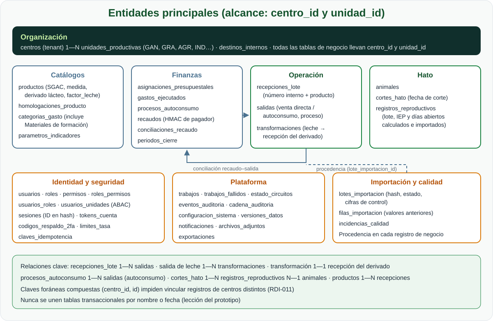

## 4.5 Modelo de datos

El modelo reemplaza las colecciones del prototipo (`units`, `budgets`, `receipts`, `lots`, `sales`, `processes`, `animals`, `products`, `expenses`, `transformations` y `parameters`) por tablas normalizadas con claves de unidad, producto, lote y proceso. Nunca une tablas transaccionales por nombre o por fecha. Separa las tablas operativas de los cálculos analíticos, que se resuelven con consultas agregadas sobre índices y caché versionada (4.6). El DDL completo está en el anexo B.

**Columnas comunes de las tablas de negocio** (RBD-005, RBD-009, RBD-010, RDI-002):

- **Alcance:** `centro_id` y `unidad_id`.
- **Procedencia:** `origen_tipo`, `lote_importacion_id`, `origen_archivo`, `origen_hoja` y `origen_fila`.
- **Archivado:** `archivado_en`, `archivado_por` y `motivo_archivo`.
- **Concurrencia:** `version`.
- **Control:** `creado_en`, `actualizado_en`, `creado_por` y `actualizado_por`.

| Dominio | Tabla | Propósito | Claves e índices principales |
|---|---|---|---|
| Organización | `centros` | Centro de formación (9124) | UNIQUE `codigo` |
| Organización | `unidades_productivas` | GAN, GRA, AGR, IND… con prefijo de lote y tipo | UNIQUE (`centro_id`, `codigo`) |
| Organización | `destinos_internos` | Clientes internos del autoconsumo y su unidad receptora | UNIQUE (`centro_id`, `nombre`) |
| Identidad | `usuarios` | Cuentas, hash Argon2id, semilla TOTP cifrada y preferencias | UNIQUE `correo`, UNIQUE `ulid` |
| Identidad | `roles`, `permisos`, `roles_permisos` | RBAC con permisos `recurso.accion` | UNIQUE `codigo` |
| Identidad | `usuarios_roles`, `usuarios_unidades` | Roles por centro y unidades asignadas (ABAC) | UNIQUE (`usuario_id`, `rol_id`, `centro_id`); PK (`usuario_id`, `unidad_id`) |
| Seguridad | `sesiones` | Sesiones del servidor con el ID convertido a hash, nivel de autenticación y expiraciones | PK `id` (SHA-256); índices (`usuario_id`) y (`ultima_actividad_en`) |
| Seguridad | `tokens_cuenta` | Invitación y recuperación (hash, un solo uso y caducidad) | UNIQUE `hash_token` |
| Seguridad | `codigos_respaldo_2fa` | Códigos de respaldo en HMAC | UNIQUE (`usuario_id`, `hmac_codigo`) |
| Seguridad | `limites_tasa` | Contadores por clave y ventana | PK `clave` |
| Seguridad | `claves_idempotencia` | Respuestas guardadas por `X-Idempotency-Key` (24 h) | UNIQUE (`usuario_id`, `clave`) |
| Auditoría | `eventos_auditoria` | Auditoría funcional encadenada por hash | UNIQUE `evento_id` y `hash_evento`; índices (`ocurrido_en`, `id`), (`actor_id`, `ocurrido_en`), (`recurso`, `recurso_id`) y `request_id` |
| Cola | `trabajos`, `trabajos_fallidos`, `estado_circuitos` | Cola durable y cortacircuitos (4.4) | Ver 4.4.2 |
| Sistema | `configuracion_sistema`, `versiones_datos`, `notificaciones`, `archivos_adjuntos` | Estado del mantenimiento y de las funcionalidades, versión de datos para la caché, avisos y soportes | PK `clave`; PK `centro_id`; índice (`usuario_id`, `leida_en`) |
| Importación | `lotes_importacion`, `filas_importacion` | Lotes con hash, estado, cifras de control y filas de prueba con errores y valores anteriores | Índices (`centro_id`, `fuente`, `hash_archivo`) y (`lote_id`, `estado`) |
| Catálogos | `productos` | Catálogo SGAC, medida, categoría de rotación, derivados lácteos con factor y metas | UNIQUE (`centro_id`, `codigo_sgac`) |
| Catálogos | `homologaciones_producto` | Texto fuente normalizado convertido en producto | UNIQUE (`centro_id`, `texto_normalizado`) |
| Catálogos | `categorias_gasto` | Mantenimiento, Alimentación y vacunas y **Materiales de formación**, con su línea y la marca de IND_17 | UNIQUE (`centro_id`, `codigo`) |
| Catálogos | `parametros_indicadores` | Metas y precios con vigencia | UNIQUE (`centro_id`, `clave`, `vigente_desde`) |
| Finanzas | `asignaciones_presupuestales` | Asignación anual con desglose | UNIQUE (`centro_id`, `unidad_id`, `vigencia`, `activa_unica`), donde `activa_unica` es una columna generada |
| Finanzas | `gastos_ejecutados` | Gastos con componente académico | Índice (`centro_id`, `unidad_id`, `archivado_en`, `fecha`) |
| Finanzas | `recaudos` | Recaudos de la DG con estados de clasificación y conciliación, identificación en HMAC | UNIQUE (`centro_id`, `clave_natural`); índices (`centro_id`, `unidad_id`, `fecha_pago`) y (`centro_id`, `estado_clasificacion`) |
| Finanzas | `conciliaciones_recaudo` | Relación entre recaudo y salida, con criterio y diferencia | UNIQUE (`recaudo_id`, `salida_id`) |
| Finanzas | `procesos_autoconsumo` | Cupos AUTO_xxx por vigencia (`unidad_id` es la unidad de origen) | UNIQUE (`centro_id`, `codigo`, `vigencia`) |
| Finanzas | `periodos_cierre` | Meses cerrados y reabiertos | UNIQUE (`centro_id`, `anio`, `mes`) |
| Operación | `recepciones_lote` | Lotes recibidos con número interno | UNIQUE (`centro_id`, `numero_interno`, `producto_id`); índice (`centro_id`, `unidad_id`, `fecha_recepcion`) |
| Operación | `salidas` | Venta directa o autoconsumo, con lote, proceso e identificador externo | UNIQUE (`centro_id`, `clave_natural`); índices (`recepcion_id`), (`proceso_id`, `fecha`) y (`centro_id`, `canal`, `fecha`) |
| Operación | `transformaciones` | Leche de origen, derivado recibido y litros asignados | UNIQUE `recepcion_derivado_id`; índice `salida_leche_id` |
| Hato | `animales` | Hembras de la unidad pecuaria | UNIQUE (`centro_id`, `unidad_id`, `identificador`) |
| Hato | `cortes_hato` | Fotografías fechadas | UNIQUE (`centro_id`, `unidad_id`, `fecha_corte`) |
| Hato | `registros_reproductivos` | Estado reproductivo por animal y corte, con IEP y días abiertos calculados e importados | UNIQUE (`corte_id`, `animal_id`) |
| Calidad | `incidencias_calidad` | Vínculos faltantes y diferencias | UNIQUE (`entidad`, `entidad_id`, `tipo`); índice (`centro_id`, `unidad_id`, `estado`, `tipo`) |
| Exportación | `exportaciones` | Archivos generados con caducidad | UNIQUE `ulid`; índice (`usuario_id`, `creado_en`) |

**Del prototipo al modelo** (el detalle por columna de los Excel está en el anexo G):

| Colección del prototipo | Tabla destino | Cambio relevante |
|---|---|---|
| `units` | `unidades_productivas` | Se añaden centro, prefijo de lote y tipo; «SIN» queda solo para los heredados |
| `budgets` | `asignaciones_presupuestales` | `academic` pasa a `materiales_formacion`; unicidad de la asignación activa por columna generada |
| `receipts` | `recaudos` | Clave natural, HMAC de la identificación, estados de clasificación y conciliación |
| `lots` | `recepciones_lote` | Producto por FK; responsable como usuario |
| `sales` | `salidas` | Recepción y proceso por FK; `id_externo` para la integración; clave natural con número de ocurrencia |
| `processes` | `procesos_autoconsumo` | Destino por catálogo |
| `animals` | `animales`, `cortes_hato` y `registros_reproductivos` | Separación entre identidad y fotografía fechada |
| `products` | `productos` y `homologaciones_producto` | `milkFactor` y `yieldTarget` pasan a `factor_leche` y `meta_rendimiento_min/max`; categoría de rotación |
| `expenses` | `gastos_ejecutados` y `categorias_gasto` | Categoría por catálogo, incluida Materiales de formación |
| `transformations` | `transformaciones` | La recepción del derivado puede crearse en la misma transacción |
| `parameters` | `parametros_indicadores` | Historial por vigencia |
