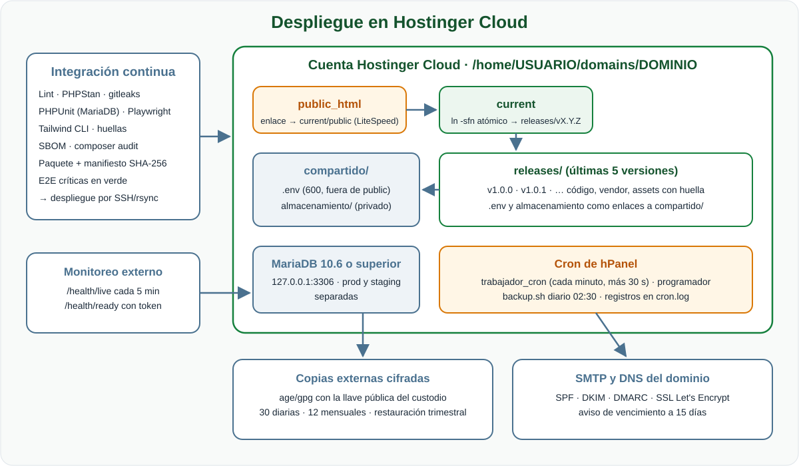

## 4.8 Checklist de migración a Hostinger (plan Cloud)

### 4.8.1 Estructura de despliegue



```text
/home/USUARIO/domains/DOMINIO/
├── public_html  →  (enlace simbólico) produccion_cab/current/public     ← raíz del documento
└── produccion_cab/
    ├── releases/
    │   ├── v1.0.0/            código de la versión (sin .env ni almacenamiento)
    │   │   ├── .env           →  ../../compartido/.env          (enlace)
    │   │   └── almacenamiento →  ../../compartido/almacenamiento (enlace)
    │   └── v1.0.1/
    ├── current  →  releases/v1.0.1                              ← cambio atómico con ln -sfn
    └── compartido/
        ├── .env                (permisos 600, fuera de public_html)
        └── almacenamiento/     (cache, registros, importaciones, exportaciones, adjuntos, estado, latidos, bloqueos)
```

> **Advertencia.** Que `public_html` pueda ser un enlace simbólico debe verificarse en la iteración 0. Hostinger usa LiteSpeed, que sigue enlaces cuyo propietario es el mismo usuario. Si no se permite, se aplica la **alternativa B**: `public_html/index.php` es un cargador de una línea (`require '/home/USUARIO/domains/DOMINIO/produccion_cab/current/public/index.php';`) y `public_html/assets` se sincroniza en cada despliegue con rsync. Ninguna de las dos opciones requiere root.

### 4.8.2 Lista de verificación de la migración

| # | Verificación | Cómo | Responsable | Estado |
|---|---|---|---|---|
| 1 | Plan Cloud (Startup o Professional) contratado; centro de datos con la menor latencia hacia Colombia (S-24) | hPanel → Plan; medición de latencia desde el centro | Titular de la cuenta | PENDIENTE (I0) |
| 2 | Dominio o subdominio y DNS: A/AAAA, SPF, DKIM y DMARC para el correo | hPanel → Dominios y DNS | Titular y TI del centro | PENDIENTE (I0) |
| 3 | SSL de Let's Encrypt activo con renovación automática; redirección HTTPS; HSTS | hPanel → SSL; SSL Labs con nota A o mejor | Proveedor | PENDIENTE (I0) |
| 4 | Versión de PHP 8.3 y extensiones (pdo_mysql, mbstring, intl, sodium, zip, fileinfo, openssl, opcache); `PASSWORD_ARGON2ID` disponible | hPanel → Configuración de PHP; `php cli/verificar_entorno.php` | Proveedor | PENDIENTE (I0) |
| 5 | `.user.ini` respetado o valores equivalentes fijados en hPanel (`display_errors` Off, límites de carga) | `phpinfo()` temporal protegido y retirado después | Proveedor | PENDIENTE (I0) |
| 6 | Versión de MariaDB 10.6 o superior; `max_user_connections`; soporte de `SKIP LOCKED`; si se pueden crear disparadores (con registro binario activo) | `SELECT VERSION()`, `SHOW VARIABLES`, migración de prueba | Proveedor | PENDIENTE (I0) |
| 7 | Bases de datos separadas para producción y staging; usuario de aplicación y, si el plan lo permite, usuario de migraciones (RBD-012) | hPanel → Bases de datos | Titular | PENDIENTE (I0) |
| 8 | Acceso SSH con llave, rsync y Git disponibles; llaves de despliegue con permisos mínimos | Conexión de prueba | Proveedor | PENDIENTE (I0) |
| 9 | `public_html` como enlace a `current/public`, o la alternativa B | Despliegue de prueba en staging | Proveedor | PENDIENTE (I0) |
| 10 | Cron cada minuto (trabajador más desfasado y programador), ruta del binario de PHP y duración máxima de 55 s | hPanel → Tareas cron; script de prueba | Proveedor | PENDIENTE (I1) |
| 11 | Almacenamiento privado con permisos (directorios 700, archivos 600) y escritura atómica (`rename` en el mismo sistema de archivos) | Prueba de la caché y de la señal de mantenimiento | Proveedor | PENDIENTE (I1) |
| 12 | Correo SMTP del dominio: cuenta de envío, puerto 465 o 587 y límite diario | hPanel → Correo; envío de prueba | Titular | PENDIENTE (I1) |
| 13 | Copias diarias del plan activas, más la copia propia cifrada fuera de Hostinger (RDL-003) | hPanel → Copias; `scripts/backup.sh` | Proveedor | PENDIENTE (I7) |
| 14 | Monitoreo externo de `/health/live` y `/health/ready` con token (ROB-012) | Servicio externo | Proveedor | PENDIENTE (I7) |
| 15 | OPcache activo; prueba de cambio de versión con la caché de rutas reales (RNF-PERF-014) | Despliegue de prueba y verificación | Proveedor | PENDIENTE (I7) |
| 16 | Firewall de aplicaciones o protección contra bots del plan; IP real del cliente si hay CDN o proxy (cabeceras confiables) | hPanel → Seguridad; prueba de `REMOTE_ADDR` | Proveedor | PENDIENTE (I7) |
| 17 | Prueba de restauración completa en staging (RDL-005) | `scripts/restaurar.sh` | Proveedor | PENDIENTE (I7) |
| 18 | Autorización escrita para las pruebas de carga en staging (RNF-PERF-015) | Acta | Titular | PENDIENTE (I6) |
| 19 | Retiro de cualquier `phpinfo` o archivo de diagnóstico; escaneo ZAP sin hallazgos altos | ZAP *baseline* | Proveedor | PENDIENTE (I8) |
| 20 | Acta de salida a producción con las pruebas de humo, la carga inicial verificada (RF-094) y la lista ASVS firmada | Acta | Contraparte y proveedor | PENDIENTE (I8) |

### 4.8.3 Elementos que requerirían root o VPS, y su alternativa en Cloud

| Necesidad | ¿Requiere root o VPS? | Alternativa adoptada en Hostinger Cloud |
|---|---|---|
| Redis para la cola o la caché | Sí: no está disponible en Cloud | Cola durable en MariaDB y caché en archivos privados (D-12, ADR-010) |
| Trabajador permanente (supervisor o systemd) | Sí | Trabajador invocado por cron cada minuto, con ejecución desfasada de 30 s (4.4.11) |
| Auditoría del sistema operativo sobre `.env` (auditd) | Sí | Permisos 600 fuera de `public_html` y verificación diaria del hash y la fecha (RS-012, RS-022) |
| Antivirus para los archivos cargados (ClamAV) | Sí | Validación estructural estricta, sin ejecución y sin contenido activo (RS-011) |
| MySQL 8.4 en lugar de MariaDB | Sí (VPS) | SQL portable verificado contra ambos motores (RNF-016) |
| PostgreSQL con RLS nativo | Sí (VPS) | Políticas equivalentes en el servidor (RDI-001, RDI-012) |
| `realpath_cache_ttl` o configuración global de PHP-FPM | Sí | Migraciones compatibles hacia atrás y mantenimiento en los cambios incompatibles (4.2.2) |
| Disparadores con el registro binario activo sin el privilegio SUPER | Depende del plan | Cadena de hash con sellado y exportación firmada (D-33, D-39) |
| Firewall a nivel de red propio | Sí | Protecciones del plan, límites de frecuencia de la aplicación y monitoreo |

### 4.8.4 Configuración equivalente para Nginx

Si un VPS con Nginx y PHP-FPM reemplaza a LiteSpeed (RNF-017), la configuración equivalente a `public/.htaccess` es:

```nginx
server {
    listen 443 ssl http2;
    server_name produccion.ejemplo.gov.co;
    root /srv/produccion_cab/current/public;
    index index.php;
    client_max_body_size 12m;

    add_header Strict-Transport-Security "max-age=31536000; includeSubDomains" always;
    add_header X-Content-Type-Options "nosniff" always;
    add_header Referrer-Policy "strict-origin-when-cross-origin" always;
    add_header X-Frame-Options "DENY" always;

    location ~ /\.(?!well-known/) { deny all; }
    location ~* \.(env|ini|log|sql|md|lock|sh|phar|bak|dist|yml|yaml)$ { deny all; }

    location /assets/ {
        add_header Cache-Control "public, max-age=31536000, immutable";
        try_files $uri =404;
    }

    location / {
        try_files $uri /index.php$is_args$args;
    }

    location = /index.php {
        include fastcgi_params;
        fastcgi_param SCRIPT_FILENAME $realpath_root$fastcgi_script_name;
        fastcgi_param DOCUMENT_ROOT $realpath_root;
        fastcgi_pass unix:/run/php/php8.3-fpm.sock;
    }

    location ~ \.php$ { return 404; }
}
```
