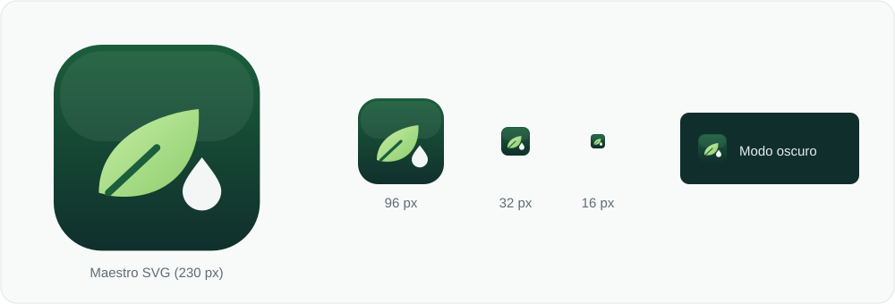

## Anexo L. Sistema de diseño, *tokens* y favicon

Este anexo es el contenido inicial de `docs/ui/sistema-diseno.md` (RUI-006). La estructura (layout), la identidad (color y tipografía) y la superficie (skeuomorfismo) se separan mediante *tokens* (RUI-001). Para cambiar a otro estilo basta con sustituir el bloque de superficies y sombras.

### L.1 *Tokens* de diseño

```css
/* public/assets/css/tokens.css — Producción CAB. Skeuomorfismo funcional, nivel sutil (RUI-002).
   Profundidad moderada: gradientes de 2 a 4 % y sombras suaves, sin texturas. Contraste AA verificado (RUI-003). */
:root {
  /* Identidad y semántica (guía de especificaciones y prototipo) */
  --color-verde: #15803d;            /* venta directa, éxito (texto AA sobre blanco) */
  --color-verde-oscuro: #14532d;
  --color-ambar: #d97706;            /* autoconsumo en barras y superficies (no texto) */
  --color-ambar-texto: #b45309;      /* autoconsumo y advertencia en texto: AA sobre blanco */
  --color-azul: #4a718f;             /* presupuesto */
  --color-azul-claro: #7896a9;       /* barra de asignación de IND_001 (no texto) */
  --color-menu: #102f2c;
  --color-fondo: #f4f6f8;
  --color-superficie: #ffffff;
  --color-texto: #1a2938;
  --color-texto-secundario: #5f6b76;
  --color-error: #c34747;
  --color-info: #1d6fa5;
  --color-linea: #dfe5ea;

  /* Tipografía: Inter autoalojada, cifras tabulares en KPI y tablas (RUI-004) */
  --fuente-base: 'Inter', system-ui, -apple-system, 'Segoe UI', sans-serif;
  --tamano-xs: .75rem;
  --tamano-sm: .875rem;
  --tamano-base: 1rem;
  --tamano-lg: 1.125rem;
  --tamano-xl: 1.375rem;
  --tamano-2xl: 1.75rem;
  --tamano-kpi: 2rem;

  /* Espaciado (escala de 4 px) y radios */
  --espacio-1: .25rem;
  --espacio-2: .5rem;
  --espacio-3: .75rem;
  --espacio-4: 1rem;
  --espacio-6: 1.5rem;
  --espacio-8: 2rem;
  --radio-pequeno: 6px;
  --radio-medio: 10px;
  --radio-grande: 14px;

  /* Superficie y elevación: capa sustituible para cambiar de estilo */
  --superficie-tarjeta: linear-gradient(180deg, #ffffff 0%, #f8faf9 100%);
  --superficie-boton: linear-gradient(180deg, #ffffff 0%, #eef2f0 100%);
  --superficie-boton-primario: linear-gradient(180deg, #1a8a47 0%, #136b37 100%);
  --sombra-0: none;
  --sombra-1: 0 1px 2px rgba(16, 47, 44, .08), inset 0 1px 0 rgba(255, 255, 255, .9);
  --sombra-2: 0 2px 6px rgba(16, 47, 44, .10), inset 0 1px 0 rgba(255, 255, 255, .85);
  --sombra-3: 0 8px 24px rgba(16, 47, 44, .14);
  --sombra-campo: inset 0 1px 2px rgba(16, 47, 44, .12);
  --sombra-boton: inset 0 1px 0 rgba(255, 255, 255, .35), 0 1px 2px rgba(16, 47, 44, .18);
  --sombra-boton-presionado: inset 0 2px 3px rgba(16, 47, 44, .25);
  --anillo-foco: 0 0 0 3px rgba(29, 111, 165, .45);
  --superficie-esqueleto: #e6ebef;
  --duracion-micro: 160ms;
}

/* Modo oscuro nativo (RUI-005): sigue al sistema salvo preferencia explícita del usuario. */
@media (prefers-color-scheme: dark) {
  :root:not([data-tema="claro"]) {
    --color-verde: #34c26d;
    --color-ambar: #f2a33a;
    --color-ambar-texto: #f6b65c;
    --color-azul: #8db1cc;
    --color-azul-claro: #6f90a6;
    --color-fondo: #0f1a1e;
    --color-superficie: #16252b;
    --color-texto: #e6edf0;
    --color-texto-secundario: #a9b6bf;
    --color-error: #f07b7b;
    --color-info: #7cc0ef;
    --color-linea: #2a3b42;
    --superficie-tarjeta: linear-gradient(180deg, #19292f 0%, #15232a 100%);
    --superficie-boton: linear-gradient(180deg, #213238 0%, #1a2a30 100%);
    --sombra-1: 0 1px 2px rgba(0, 0, 0, .35), inset 0 1px 0 rgba(255, 255, 255, .04);
    --sombra-2: 0 2px 8px rgba(0, 0, 0, .40), inset 0 1px 0 rgba(255, 255, 255, .05);
    --sombra-campo: inset 0 1px 2px rgba(0, 0, 0, .45);
    --superficie-esqueleto: #22333a;
  }
}
:root[data-tema="oscuro"] { color-scheme: dark; }

/* Componentes con relieve sutil y estado presionado reconocible */
.tarjeta { background: var(--superficie-tarjeta); border: 1px solid var(--color-linea); border-radius: var(--radio-grande); box-shadow: var(--sombra-1); }
.kpi-valor { font-size: var(--tamano-kpi); font-variant-numeric: tabular-nums; }
.boton { background: var(--superficie-boton); border: 1px solid var(--color-linea); border-radius: var(--radio-medio); box-shadow: var(--sombra-boton); min-block-size: 2.75rem; }
.boton:active { box-shadow: var(--sombra-boton-presionado); transform: translateY(1px); }
.boton:focus-visible, .campo:focus-visible { outline: none; box-shadow: var(--anillo-foco); }
.campo { background: var(--color-superficie); border: 1px solid var(--color-linea); border-radius: var(--radio-pequeno); box-shadow: var(--sombra-campo); }
@media (prefers-reduced-motion: reduce) { .boton:active { transform: none; } * { transition-duration: 0ms !important; } }
```

| Componente (`docs/ui/`) | Contenido documentado |
|---|---|
| `sistema-diseno.md` | Este anexo: *tokens*, escala tipográfica, espaciado, radios, elevación, estados, iconografía y comportamiento adaptable |
| `toast.md` | Taxonomía, duración, pausa, apilamiento, regiones `aria-live`, contrato `HX-Trigger` y `X-Toast-Type` |
| `modal-confirm.md` | `data-confirmar` y sus variantes, foco atrapado, Esc, foco inicial en acciones destructivas |
| `inline-alert.md` | Errores por campo, resumen de errores, `aria-invalid` y `aria-describedby` |
| `empty-state.md` | Estructura, redacción y acción sugerida; respuesta 200 frente a 204 |
| `skeleton-loader.md` | Variantes (tabla, tarjetas KPI, gráfico), umbral de 300 ms, límite de 8 s, `aria-busy`, movimiento reducido y pruebas (RUI-016) |
| `table-dense.md` | Encabezado fijo, orden `aria-sort`, filtros, paginación, selección y acciones masivas, densidad |
| `bento-card.md` | Tamaños 1×1, 2×1 y 2×2, jerarquía, vista previa al pasar el puntero o enfocar, distribución adaptable |
| `graficos-svg.md` | Barras combinadas, anillo, velocímetro, tendencia; alternativa tabular y *tooltips* accesibles |

### L.2 Favicon propio (RUI-007)



```svg archivo=public/favicon.svg
<svg xmlns="http://www.w3.org/2000/svg" viewBox="0 0 64 64">
  <defs>
    <linearGradient id="fondo" x1="0" y1="0" x2="0" y2="1">
      <stop offset="0" stop-color="#1b5e3b"/>
      <stop offset="1" stop-color="#102f2c"/>
    </linearGradient>
    <linearGradient id="hoja" x1="0" y1="0" x2="1" y2="1">
      <stop offset="0" stop-color="#c8efa6"/>
      <stop offset="1" stop-color="#8ccc6c"/>
    </linearGradient>
  </defs>
  <rect width="64" height="64" rx="15" fill="url(#fondo)"/>
  <rect x="2" y="2" width="60" height="28" rx="13" fill="#ffffff" opacity=".07"/>
  <path d="M14 46c0-18 20-25 31-26 1 18-10 29-27 27z" fill="url(#hoja)"/>
      <path d="M17 46l15-14" stroke="#1b5e3b" stroke-width="2.2" stroke-linecap="round"/>
  <path d="M46 35c3 4 6 7.5 6 10.5a6 6 0 0 1-12 0c0-3 3-6.5 6-10.5z" fill="#ffffff" opacity=".95"/>
</svg>
```

| Variante | Archivo | Uso |
|---|---|---|
| SVG | `public/favicon.svg` | Navegadores modernos (`<link rel="icon" type="image/svg+xml">`) |
| PNG 32×32 | `public/favicon-32.png` | Respaldo de escritorio |
| ICO de 16 y 32 | `public/favicon.ico` | Navegadores y herramientas heredadas |
| PNG 192×192 y 512×512 | `public/icono-192.png`, `public/icono-512.png` | Manifiesto web |
| PNG 512 con margen seguro | `public/icono-512-mascara.png` | Ícono adaptable (`purpose: maskable`) |
| Apple touch 180×180 | `public/apple-touch-icon.png` | iOS |
| Manifiesto | `public/site.webmanifest` | Nombre, colores e íconos |

Las variantes PNG e ICO se generan en la CI a partir del SVG (sharp) y se verifica su legibilidad a 16 px. Si la oficina de comunicaciones autoriza el uso de marca (S-03), el favicon se ajusta sin cambiar las rutas.

```json archivo=public/site.webmanifest
{
  "name": "Producción CAB",
  "short_name": "Producción CAB",
  "description": "Gestión y tableros de mando de la producción del Centro Agropecuario de Buga",
  "lang": "es-CO",
  "start_url": "/",
  "scope": "/",
  "display": "standalone",
  "background_color": "#f4f6f8",
  "theme_color": "#102f2c",
  "icons": [
    { "src": "/icono-192.png", "sizes": "192x192", "type": "image/png" },
    { "src": "/icono-512.png", "sizes": "512x512", "type": "image/png" },
    { "src": "/icono-512-mascara.png", "sizes": "512x512", "type": "image/png", "purpose": "maskable" }
  ]
}
```
